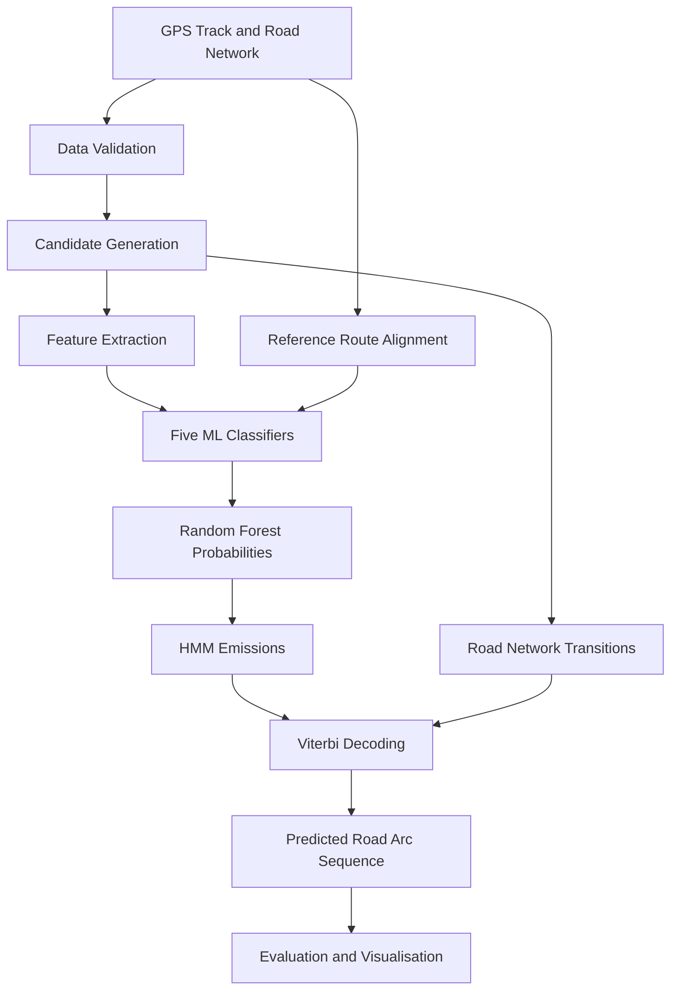

# PathSnap
### Machine-Learning GPS Map Matching with HMM-Based Route Reconstruction

PathSnap is a GPS trajectory map-matching system that assigns noisy GPS observations to directed road-network segments. It combines spatial candidate generation, feature engineering, supervised machine learning and Hidden Markov Model (HMM) sequence decoding to reconstruct geographically consistent routes.

The system uses five candidate-scoring models:
- Logistic Regression
- Random Forest
- Multi-Layer Perceptron (MLP)
- LightGBM
- Gaussian Naive Bayes

Random Forest is used as the candidate-scoring model for the HMM/Viterbi route reconstruction pipeline.

---

## Contents

1. [Project Overview](#project-overview)
2. [Dataset](#dataset)
3. [System Architecture](#system-architecture)
4. [Methodology](#methodology)
5. [Machine Learning Models](#machine-learning-models)
6. [Model Evaluation](#model-evaluation)
7. [HMM and Viterbi Route Reconstruction](#hmm-and-viterbi-route-reconstruction)
8. [Bayesian Hyperparameter Optimisation](#bayesian-hyperparameter-optimisation)
9. [Repository Structure](#repository-structure)
10. [Installation](#installation)
11. [Running the Pipeline](#running-the-pipeline)
12. [HMM Evaluation](#hmm-evaluation)
13. [Web Application](#web-application)
14. [Known Limitations](#known-limitations)
15. [Future Improvements](#future-improvements)
16. [Team](#team)

---

## 1. Project Overview

GPS devices produce noisy location observations due to measurement errors, signal interference and environmental conditions. These observations do not necessarily lie directly on the roads travelled by a vehicle.

Map matching addresses this problem by identifying the most likely road segments corresponding to a sequence of GPS observations.

PathSnap approaches map matching as a two-stage process.

**Stage 1: Candidate Generation and Classification**

For every GPS observation:
- Retrieve nearby directed road segments.
- Extract spatial, geometric and movement-related features.
- Score candidate road segments using supervised machine-learning classifiers.
- Select the most likely candidate using the trained model.

**Stage 2: Sequential Route Reconstruction**

- Convert Random Forest probabilities into HMM emission scores.
- Construct transition scores using the directed road network.
- Apply the Viterbi algorithm to identify the most likely sequence of road segments.

The objective is to improve route consistency by considering both individual GPS observations and the connectivity of consecutive road segments.

---

## 2. Dataset

The dataset consists of individual trips represented through four files.

| File | Description |
|---|---|
| `.track` | GPS observations containing longitude, latitude and timestamps |
| `.nodes` | Road-network node coordinates |
| `.arcs` | Directed connections between road-network nodes |
| `.route` | Chronological sequence of reference road-arc IDs |

### Dataset partitions

| Partition | Number of trips | Purpose |
|---|---:|---|
| Training | 80 | Model development, feature engineering and validation |
| Student Test | 10 | Held-out development-stage evaluation |
| Evaluator Test | 10 | Reserved final evaluation |

The training and student-test partitions are used for the documented development experiments.

The evaluator partition must remain isolated from model development, parameter tuning and student-side prediction logic. Its reference labels must not be exposed through the public repository or frontend.

---

## 3. System Architecture

The PathSnap pipeline consists of the following components:

1. Data loading and validation
2. Candidate generation
3. Feature extraction
4. Route alignment and label generation
5. Model training and comparison
6. Random Forest probability generation
7. HMM emission and transition construction
8. Viterbi sequence decoding
9. Route evaluation and geographical visualisation

### Processing workflow



---

## 4. Methodology

### 4.1 Candidate Generation

Candidate generation identifies road segments that may correspond to each GPS observation.

The implementation uses:

- Road-arc sampling at approximately 30-metre intervals.
- Unit-sphere XYZ coordinate representation.
- SciPy `cKDTree` for spatial indexing.
- Progressive search radii of 100 m, 250 m, 500 m and 1,000 m.
- Exact point-to-segment distance refinement.
- Top-20 candidate road arcs per GPS observation.

Candidate coverage is important because a classifier cannot select the correct road segment if that segment is absent from the candidate set.

**Recorded candidate-generation results:**

| Metric | Result |
|---|---:|
| Training GPS observations | 208,417 |
| Observations with candidates | 196,176 |
| Uncovered observations | 12,241 |
| Training Top-20 coverage | 94.13% |
| Average training trip coverage | 98.39% |
| Trip 33 coverage | 37.13% |
| Trip 54 coverage | 60.83% |
| Student-test candidate recall | 99.95% |

The training coverage and student-test candidate recall refer to different partitions and should not be interpreted as the same metric.

### 4.2 Feature Engineering

Candidate road segments are represented using spatial, movement-related and geometric features.

The feature representation contains 11 model inputs.

| Feature group | Features |
|---|---|
| GPS-to-segment geometry | `distance_m`, `projection_fraction`, `heading_difference` |
| GPS movement | `gps_speed_mps`, `gps_displacement_m`, `time_gap_s` |
| Segment properties | `segment_length_m` |
| Circular bearing encodings | `gps_bearing_sin`, `gps_bearing_cos`, `segment_bearing_sin`, `segment_bearing_cos` |

Circular encoding represents angular information using sine and cosine values, avoiding the discontinuity between bearings close to 0° and 360°.

### 4.3 Feature Selection

Feature selection combines:

- Variance threshold analysis.
- Spearman correlation analysis.
- Variance Inflation Factor (VIF) analysis.

The recorded feature-selection analysis reports that retained features have VIF values below 3.7.

Generated feature-selection outputs are stored in:

```text
outputs/feature_selection/
```

### 4.4 Route Alignment and Label Generation

The reference route is aligned with the GPS trajectory using monotonic route alignment.

The alignment maintains non-decreasing route progress along the trajectory.

Candidate road arcs matching the aligned reference arc are assigned positive labels, while other candidates are assigned negative labels.

These labels are used for supervised model training and evaluation.

The reference labels are route-derived and should be interpreted as provisional evaluation labels rather than independently verified ground truth.

---

## 5. Machine Learning Models

Five classifiers were implemented and compared.

| Model | Description |
|---|---|
| Logistic Regression | Linear probabilistic classification baseline |
| Random Forest | Ensemble of decision trees |
| MLP | Neural network with multiple fully connected layers |
| LightGBM | Gradient-boosted decision tree model |
| Gaussian Naive Bayes | Probabilistic classifier based on Gaussian feature distributions |

### Random Forest configuration

The recorded Random Forest pipeline uses:

- Median imputation for missing feature values.
- 300 decision trees.
- `min_samples_split = 4`.
- `min_samples_leaf = 2`.
- `class_weight = balanced`.
- `n_jobs = -1`.
- `random_state = 42`.

The saved model is expected at:

```text
outputs/model_results/saved_models/random_forest.joblib
```

The model is used as the candidate-scoring component for the HMM pipeline.

---

## 6. Model Evaluation

The five models were evaluated using a trip-grouped 25% hold-out split with `GroupShuffleSplit` and `random_state=42`.

Grouping by trip helps prevent observations from the same trip appearing in both training and validation subsets.

### Recorded validation results

| Model | Candidate Accuracy | Precision | Recall | Binary F1 | Candidate Macro F1 | Log Loss | Observation Top-1 |
|---|---:|---:|---:|---:|---:|---:|---:|
| Random Forest | 0.97156 | 0.72902 | 0.69082 | 0.70941 | 0.84723 | 0.09889 | 0.73031 |
| MLP | 0.97075 | 0.74214 | 0.64030 | 0.68747 | 0.83606 | 0.08434 | 0.72137 |
| LightGBM | 0.94793 | 0.48993 | 0.88034 | 0.62952 | 0.80076 | 0.13619 | 0.72608 |
| Logistic Regression | 0.78388 | 0.17755 | 0.90881 | 0.29707 | 0.58469 | 0.40659 | 0.51636 |
| Gaussian Naive Bayes | 0.94802 | 0.43992 | 0.12581 | 0.19567 | 0.58440 | 0.17928 | 0.61153 |

### Observations

- Random Forest achieved the highest candidate Macro F1 and observation-level Top-1 accuracy.
- MLP achieved the lowest candidate log loss.
- LightGBM achieved the highest candidate recall.
- Logistic Regression provided a comparatively simple baseline.
- Gaussian Naive Bayes achieved high candidate accuracy but substantially lower recall.

Candidate-level classification metrics and observation-level Top-1 accuracy measure different aspects of the pipeline and should be interpreted separately.

---

## 7. HMM and Viterbi Route Reconstruction

The HMM stage improves route reconstruction by considering transitions between consecutive road-segment candidates.

### 7.1 Emission Probabilities

Random Forest candidate probabilities are used to construct emission scores.

The scores are normalised within each GPS observation.

These are classifier-derived scores and should not be interpreted as independently calibrated generative likelihoods.

Implementation:

```text
src/hmm/emission_probabilities.py
```

### 7.2 Transition Probabilities

Transition scores represent the likelihood of moving from one candidate road arc to another.

The implementation considers:

- Directed road-network connectivity.
- Haversine road-arc lengths.
- Bounded shortest-path search.
- Projected positions along road segments.
- Observed GPS displacement.
- Reverse-direction penalties.
- Implied vehicle speed.

Recorded transition parameters include:

| Parameter | Value |
|---|---:|
| Middle-path search cutoff | 1,000 m |
| Unreachable transition score | 1e-8 |
| Reverse same-arc penalty | 0.05 |
| Implied-speed threshold | 70 m/s |
| Penalty above speed threshold | 0.001 |

Transition scores are normalised where applicable.

Implementation:

```text
src/hmm/transition_probabilities.py
```

### 7.3 Viterbi Decoding

The Viterbi algorithm identifies the most likely sequence of hidden states using dynamic programming.

The implementation uses:

- Log-space probability calculations.
- Dynamic programming.
- Backtracking.
- One selected road arc per GPS observation.

Implementation:

```text
src/hmm/viterbi.py
```

### 7.4 Student-Test Evaluation

The RF and RF + HMM/Viterbi pipelines were evaluated on ten student-test trips containing 19,160 GPS observations.

| Metric | RF Top-1 | RF + HMM/Viterbi |
|---|---:|---:|
| Accuracy | 0.80433 | 0.86660 |
| Macro Precision | 0.68542 | 0.84707 |
| Macro Recall | 0.62442 | 0.81995 |
| Macro F1 | 0.64124 | 0.82511 |
| Weighted F1 | 0.85249 | 0.88888 |
| Mean selected GPS-to-road distance | 6.423 m | 6.579 m |
| Median selected GPS-to-road distance | 5.148 m | 5.287 m |

Additional recorded results:

- Total observations: 19,160.
- Predictions changed by HMM: 3,208.
- RF-wrong to HMM-correct: 1,892.
- RF-correct to HMM-wrong: 699.
- Both correct: 14,712.
- Both wrong: 1,857.
- Selected-transition reachability: 99.979%.

HMM/Viterbi improved pooled accuracy and Macro F1. However, the mean and median selected GPS-to-road distances increased slightly. Therefore, improvements in label agreement do not necessarily imply improvements in every geometric metric.

---

## 8. Bayesian Hyperparameter Optimisation

Bayesian hyperparameter optimisation was explored for Random Forest using Optuna's Tree-structured Parzen Estimator (TPE) sampler.

The objective was to maximise trip-grouped cross-validation Macro F1.

### Recorded optimisation setup

- Model: Random Forest.
- Optimisation framework: Optuna.
- Sampler: TPE.
- Planned trials: 30.
- Completed pilot trials: 3.
- Representative training trips: 6.
- Grouped folds: 3.

The experiment was a time-limited pilot rather than a completed 30-trial search.

### Pilot comparison

| Metric | Untuned RF (300 trees) | Tuned RF (100 trees) |
|---|---:|---:|
| CV Macro F1 | 0.8295 | 0.8426 |
| Student-test Top-1 | 0.8121 | 0.8105 |
| Student-test Macro F1 | 0.8786 | 0.8714 |
| Inference time | 9.37 s | 3.19 s |

### Interpretation

The tuned model improved the recorded cross-validation Macro F1 and reduced inference time by approximately two-thirds.

However, student-test Top-1 and Macro F1 were slightly lower than the untuned model.

The pilot therefore does not establish that hyperparameter tuning improves the final full-data model. The untuned 300-tree Random Forest remains the official baseline.

The tuning objective did not use student-test data, and the evaluator partition was not accessed.

Notebook:

```text
notebooks/04_bayesian_hyperparameter_optimization.ipynb
```

Detailed report:

```text
reports/section_4_bayesian_optimization.md
```

---

## 9. Repository Structure

```text
Team11_PathSnap/
│
├── backend/
│   ├── main.py
│   └── requirements.txt
│
├── frontend/
│   └── app.py
│
├── data/
│   └── processed/
│
├── src/
│   ├── data_processing.py
│   ├── candidate_generation.py
│   ├── feature_extraction.py
│   ├── feature_selection.py
│   ├── ground_truth_alignment.py
│   ├── monotonic_alignment.py
│   ├── batch_feature_extraction.py
│   ├── batch_alignment.py
│   ├── train_models.py
│   ├── validate_alignment.py
│   ├── validate_candidates.py
│   ├── diagnose_candidate_coverage.py
│   └── hmm/
│       ├── emission_probabilities.py
│       ├── transition_probabilities.py
│       ├── viterbi.py
│       ├── evaluate_viterbi.py
│       └── run_pipeline.py
│
├── notebooks/
│   └── 04_bayesian_hyperparameter_optimization.ipynb
│
├── outputs/
│   ├── feature_selection/
│   ├── model_results/
│   ├── hyperparameter_optimization/
│   └── hmm_results/
│
├── reports/
│   └── section_4_bayesian_optimization.md
│
├── tests/
│   └── test_hmm_pipeline.py
│
├── requirements.txt
├── .gitignore
└── README.md
```

Generated outputs, locally saved model artifacts and datasets may not all be tracked in Git. Consult the relevant scripts and `.gitignore` when reproducing the experiments.

**Important:** Do not commit the evaluator dataset or its reference routes to the public repository.

---

## 10. Installation

### Prerequisites

- Python 3.
- Git.
- pip.
- Access to the authorised training and student-test dataset.

### Clone the repository

```bash
git clone https://github.com/krista9669/Team11_PathSnap.git

cd Team11_PathSnap
```

### Create a virtual environment

Windows PowerShell:

```powershell
python -m venv .venv

.venv\Scripts\Activate.ps1
```

Linux/macOS:

```bash
python -m venv .venv

source .venv/bin/activate
```

### Install dependencies

```bash
pip install -r requirements.txt
```

Install additional packages required by the web application and tests if they are not already included:

```bash
pip install fastapi "uvicorn[standard]" streamlit streamlit-folium requests pytest
```

### Configure the dataset path

The pipeline currently uses local dataset path constants in several source files.

Configure the appropriate dataset root before running scripts that load raw data.

Relevant modules include:

```text
src/data_processing.py
src/candidate_generation.py
src/feature_extraction.py
src/batch_feature_extraction.py
src/batch_alignment.py
src/monotonic_alignment.py
src/ground_truth_alignment.py
src/validate_candidates.py
src/hmm/run_pipeline.py
```

The expected local directory layout is:

```text
DATA_ROOT/
├── train/
└── student_test/
```

Do not point student-side development scripts at the evaluator partition.

---

## 11. Running the Pipeline

Run commands from the repository root.

### Step 1: Data validation

```bash
python src/data_processing.py
```

### Step 2: Candidate generation and feature extraction

```bash
python src/batch_feature_extraction.py
```

### Step 3: Feature selection

```bash
python src/feature_selection.py
```

### Step 4: Route alignment

```bash
python src/batch_alignment.py
```

### Step 5: Train and compare the five models

```bash
python src/train_models.py
```

The training stage saves model comparison outputs and the Random Forest model.

Expected model path:

```text
outputs/model_results/saved_models/random_forest.joblib
```

Training can take considerable time depending on the machine and dataset size.

---

## 12. HMM Evaluation

The HMM pipeline requires the trained Random Forest model.

Run the HMM pipeline using module execution from the repository root:

```bash
python -m src.hmm.run_pipeline
```

Run on selected training trips:

```bash
python -m src.hmm.run_pipeline --trip-ids 5 13 16
```

Run on the student-test partition:

```bash
python -m src.hmm.run_pipeline --partition student_test
```

The student-test run uses the already-trained model and does not retrain the classifier.

Generated HMM outputs are stored in:

```text
outputs/hmm_results/
```

Evaluation summaries are stored under:

```text
outputs/hmm_results/evaluation/
```

---

## 13. Tests

Run the available test suite:

```bash
python -m pytest tests -v
```

The recorded HMM unit tests cover:

1. Emission probability normalisation.
2. Transition matrix dimensions and unreachable-transition penalties.
3. Viterbi prediction length.
4. Rejection of invalid transition probabilities.

These tests verify selected HMM components; they do not constitute complete end-to-end API or frontend integration testing.

---

## 14. Web Application

PathSnap includes:

- FastAPI backend.
- Streamlit frontend.
- Folium geographical visualisation.

### Start the backend

```bash
uvicorn backend.main:app --reload --host 0.0.0.0 --port 8000
```

API documentation:

```text
http://127.0.0.1:8000/docs
```

### Start the frontend

In a separate terminal:

```bash
streamlit run frontend/app.py
```

The current application provides trip selection, GPS trajectory visualisation, road-network geometry and reference-route layers.

### Current integration status

The current repository version documents the `/predict` endpoint as a placeholder.

The trained Random Forest and HMM/Viterbi pipeline have not yet been fully connected to the API prediction endpoint.

The frontend also requires API URL configuration for a two-laptop demonstration.

Therefore, the existing application should be treated as a geographical visualisation and API prototype, not as a completed end-to-end prediction deployment.

---

## 15. Known Limitations

- **Provisional reference labels:** Labels are derived from route alignment and are not independently verified ground truth.
- **Candidate coverage:** Some training trips have substantially lower candidate coverage than the overall average.
- **HMM trade-offs:** Sequential decoding improves pooled student-test accuracy and Macro F1, but can change previously correct predictions and does not improve every geometric metric.
- **Bayesian optimisation:** Only 3 of 30 planned trials were completed in the recorded pilot.
- **Model deployment:** The trained Random Forest and HMM/Viterbi components are not yet fully integrated into `/predict`.
- **Configuration:** Several dataset paths and the frontend API URL require local configuration.
- **Dependencies:** The root and backend dependency files should be consolidated and verified using a clean installation.
- **Evaluation discipline:** The evaluator partition must remain isolated from development and tuning.

---

## 16. Future Improvements

1. Complete Random Forest and HMM/Viterbi integration with the FastAPI prediction endpoint.
2. Configure the backend and frontend for communication across two laptops.
3. Move dataset paths and service URLs into environment-based configuration.
4. Complete the full Bayesian optimisation experiment.
5. Improve candidate coverage for difficult training trajectories.
6. Expand automated tests to cover the complete inference pipeline.
7. Improve HMM transition modelling for disconnected or difficult road-network segments.
8. Capture genuine application and API demonstration evidence.
9. Improve documentation and reproducibility of the complete pipeline.

---

## Team

**Team 11**

| Sl. No. | University ID |
|:---:|---|
| 1 | PES2UG24CS231 |
| 2 | PES2UG24CS232 |
| 3 | PES2UG24CS233 |
| 4 | PES2UG24CS234 |